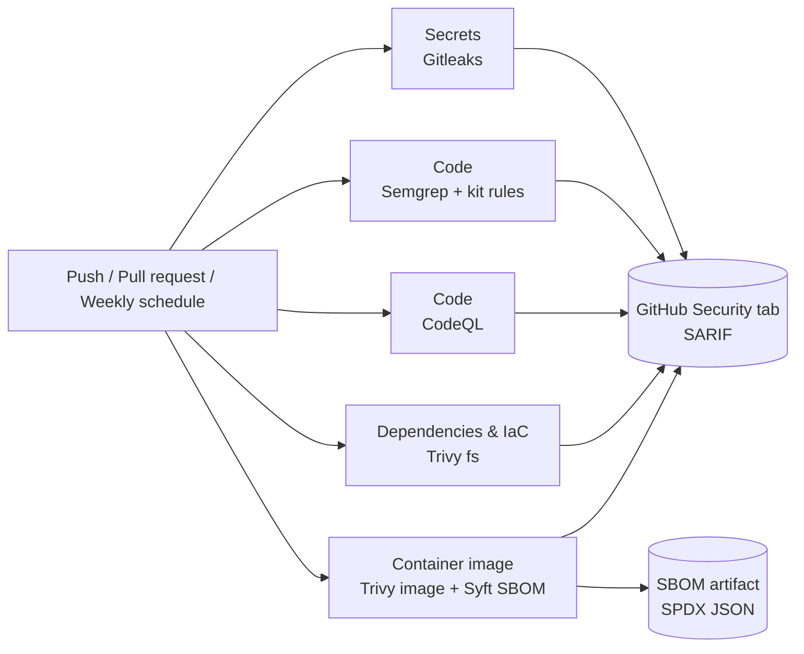

# pipeline-security-kit

[](https://github.com/luan-evangelista/pipeline-security-kit/actions/workflows/test-rules.yml)


**A production-grade DevSecOps pipeline for any GitHub repository, in ten lines of YAML.**

Five security layers, one reusable workflow, zero paid accounts. Every pull request is checked for leaked secrets, insecure code, vulnerable dependencies, risky infrastructure configuration and vulnerable container images, and every result lands in GitHub's **Security** tab, where your team already works.

On top of the standard open-source scanners, the kit ships **custom Semgrep rules for payment and fintech code**: card data in logs, disabled TLS, SQL injection in Go, weak hashing and hardcoded JWT keys. These are the mistakes that turn into PCI DSS findings and incident reports, and generic rulesets routinely miss them.

---

## Why teams use it

- **Ten minutes to a working pipeline.** One `uses:` line. No servers, no agents, no SaaS dashboard to buy.
- **Blocks what matters, reports the rest.** The build fails only on findings a developer can actually fix today. Noise stays visible but never blocks, so the pipeline keeps the team's trust.
- **Built for regulated code.** Rules map to CWE and PCI DSS requirements, and the rollout and triage guides give you an audit-friendly process for exceptions and fix deadlines.
- **The pipeline itself is hardened.** Supply-chain attacks against CI are real. Every action is pinned to a commit SHA, every downloaded binary is checksum-verified, and every job runs with least privilege.
- **Tested like code.** Every custom rule has unit tests that prove it catches the bad pattern and ignores the safe one, and they run on every change to this repository.

---

## Quick start

Create `.github/workflows/security.yml` in your repository:

```yaml
name: Security

on:
  push:
    branches: [main]
  pull_request:
  schedule:
    - cron: "23 6 * * 1"

permissions:
  contents: read

jobs:
  security:
    uses: luan-evangelista/pipeline-security-kit/.github/workflows/security-scan.yml@<commit-sha>
    permissions:
      contents: read
      security-events: write
    with:
      codeql-languages: '["javascript-typescript"]'
      docker-context: .
```

That is the whole integration. Open a pull request and results show up in the checks and in **Security → Code scanning**. The weekly `schedule` re-scans unchanged code against newly published CVEs. A ready-to-copy version lives in [`examples/security.yml`](examples/security.yml).

> Pin `@<commit-sha>` (and the `kit-ref` input) to a commit of this repository, not to a branch. That is how you would want any third-party workflow to run in your CI.

---

## How it works



All jobs run in parallel. Each one uploads a SARIF report even when it fails, so you always see the full picture, and then applies its own gate.

---

## What is actually tested, and how deep

Security tools differ a lot in *how* they look at your code. The table below is honest about the technique each layer uses, because that defines what it can and cannot find.

| Layer | Tool | Technique | What it inspects | Blocks the build when | Always reports |
| --- | --- | --- | --- | --- | --- |
| **Secrets** | Gitleaks 8.30 | Pattern + entropy matching | **Entire git history**, every commit and branch fetched, not just the current files | Any secret is found | Yes (values redacted) |
| **Code (fast)** | Semgrep 1.184 | Syntactic / semantic pattern matching on the AST | Source files in every language Semgrep supports, using the kit's rules + registry rulesets (`p/default` by default) | A rule with `ERROR` severity matches | Yes |
| **Code (deep)** | CodeQL, `security-extended` suite | Inter-procedural **data-flow and taint analysis** (source → sink) | The languages you list in `codeql-languages` | Never, report only | Yes |
| **Dependencies** | Trivy (fs, `vuln`) | Software composition analysis: lockfiles matched against public vulnerability databases | npm, Go modules, pip, Maven, Cargo, Bundler, Composer, NuGet and other lockfiles in the repo | A CVE in `fail-on` severities **that has a fixed version** | Yes, all severities |
| **Configuration** | Trivy (fs, `misconfig`) | Policy checks against known misconfiguration rules | Dockerfiles, Kubernetes manifests, Terraform, CloudFormation, Helm charts | A misconfiguration in `fail-on` severities | Yes, all severities |
| **Container image** | Docker build + Trivy (image) | SCA on the **built image** | OS packages of the base image and libraries installed into it | A CVE in `fail-on` severities that has a fix | Yes, all severities |
| **SBOM** | Syft (Anchore) | Inventory | Every package in the built image | Never | SPDX JSON artifact kept for 30 days |

### Reading the depth levels

- **Pattern matching (Gitleaks, Semgrep)** is fast, precise and predictable. It finds a dangerous call or a leaked credential wherever it appears. It does not follow a value across functions or files, so the kit's rules are written to catch the realistic, local shapes of each mistake.
- **Data-flow analysis (CodeQL)** follows untrusted input from where it enters (an HTTP request, for example) to where it becomes dangerous (a SQL query, a shell command), across functions. It finds injection bugs that pattern matching cannot, at the cost of longer runs. It is report-only here so it never blocks a merge on a finding that needs human review.
- **Composition analysis (Trivy)** does not read your code. It reads what you depend on and compares versions against published advisories. It is only as current as those databases, which is why the weekly scheduled run matters.

### What the default gate means in practice

With the default `fail-on: CRITICAL,HIGH`, a pull request is blocked by:

1. any secret anywhere in the git history,
2. any `ERROR`-severity Semgrep finding (every kit rule is `ERROR`),
3. a critical or high CVE in a dependency or image layer **that can be fixed by upgrading**,
4. a critical or high infrastructure misconfiguration.

Everything else, including CodeQL results, medium and low findings, and CVEs without an available fix, is reported in the Security tab without blocking.

---

## Custom rules for payment and fintech code

Generic rulesets are good at generic bugs. These rules target what hurts payment systems. Each one maps to a CWE and, where relevant, a PCI DSS requirement.

| Rule | Languages | Catches | Standard |
| --- | --- | --- | --- |
| `pan-in-logs` | TS/JS, Go | Card number, CVV/CVC or PIN passed to a logger | CWE-532 · PCI DSS 3.3, 3.4 |
| `tls-verification-disabled` | TS/JS, Go | `rejectUnauthorized: false`, `NODE_TLS_REJECT_UNAUTHORIZED=0`, `InsecureSkipVerify: true` | CWE-295 · PCI DSS 4.2.1 |
| `sql-string-building-go` | Go | SQL built with `fmt.Sprintf` or `+`, directly or through a variable | CWE-89 · OWASP A03 |
| `weak-password-hash` | TS/JS, Go | MD5 and SHA-1 | CWE-916 |
| `jwt-hardcoded-secret` | TS/JS, Go | JWTs signed or verified with a literal key | CWE-798 |

### Exactly what each rule detects

**`pan-in-logs`**
- **TS/JS:** `console.*` and any `logger.log/info/warn/error/debug/trace/fatal` call receiving a variable or property named `pan`, `cardNumber`, `card_number`, `ccNumber`, `cvv`, `cvc`, `cvv2`, `securityCode` or `pin` (case-insensitive), including nested inside other arguments such as `{ card: payment.cardNumber }`.
- **Go:** `log`, `slog`, `logger` and `fmt` print functions (`Print*`, `Info`, `Warn`, `Error`, `Debug`, `Fatal*`) receiving a variable or struct field with one of those names.
- **Allowed:** masked values (`maskPan(cardNumber)`) and internal IDs.
- **Depth:** name-based. It catches the common case of logging the field by name; it will not catch card data hidden in a generic object such as `logger.info(req.body)`.

**`tls-verification-disabled`**
- **TS/JS:** any object literal containing `rejectUnauthorized: false` (HTTPS agents, axios, database and queue clients) and assignments of `"0"` to `NODE_TLS_REJECT_UNAUTHORIZED`.
- **Go:** `tls.Config{...}` literals with `InsecureSkipVerify: true`.
- **Depth:** catches the setting where it is written as a literal; a value set later as `cfg.InsecureSkipVerify = true` is left to CodeQL and Semgrep registry rules.

**`sql-string-building-go`**
- `Query`, `QueryRow`, `Exec`, `Prepare` and their `Context` variants called with `fmt.Sprintf(...)` or string concatenation, either inline or through a variable built with `:=` earlier in the same function.
- **Allowed:** parameterized queries (`db.Query("... WHERE id = ?", id)`).
- **Depth:** local to a function. Queries assembled across functions or with `strings.Builder` are covered by CodeQL's taint analysis.

**`weak-password-hash`**
- **Go:** `md5.Sum`, `md5.New`, `sha1.Sum`, `sha1.New`.
- **TS/JS:** `crypto.createHash("md5")` and `createHash("sha1")`.
- **Depth:** flags every use, not only passwords. Legitimate non-security uses (cache keys, legacy checksums) should be suppressed with a reason, which leaves an audit trail.

**`jwt-hardcoded-secret`**
- **TS/JS:** `jwt.sign(payload, "literal", ...)` and `jwt.verify(token, "literal", ...)`.
- **Go:** `token.SignedString([]byte("literal"))`, directly or through a key variable declared with `:=` or `var` in the same function.
- **Allowed:** keys loaded from the environment or a secret manager.

### How the rules are tested

Every rule ships with test files in [`tests/`](tests/) that annotate real code with the expected outcome:

```go
// ruleid: sql-string-building-go
db.Query(fmt.Sprintf("SELECT id FROM users WHERE email = '%s'", email))

// ok: sql-string-building-go
db.QueryRowContext(ctx, "SELECT id FROM users WHERE email = ?", email)
```

`semgrep --test` fails if a rule **misses a `ruleid` line** (false negative) or **fires on an `ok` line** (false positive). The [`Test rules`](.github/workflows/test-rules.yml) workflow runs this on every push and pull request.

| Rule family | Rule IDs | Must catch | Must ignore |
| --- | --- | --- | --- |
| `pan-in-logs` | 2 | 5 | 3 |
| `tls-verification-disabled` | 2 | 3 | 2 |
| `sql-string-building-go` | 1 | 3 | 1 |
| `weak-password-hash` | 2 | 2 | 2 |
| `jwt-hardcoded-secret` | 2 | 4 | 2 |
| **Total** | **9** | **17** | **10** |

Run them yourself:

```bash
pip install semgrep
semgrep --test --config rules/ tests/          # rule unit tests
semgrep scan --config rules/ path/to/your/code # use the rules on your own code
```

---

## Configuration

Every input is optional. Layers without their input (CodeQL, container) are skipped.

| Input | Default | What it does |
| --- | --- | --- |
| `semgrep-rulesets` | `p/default` | Registry rulesets added to the kit's rules, space-separated (e.g. `p/default p/typescript p/golang`) |
| `codeql-languages` | `[]` | JSON list of CodeQL languages, e.g. `'["javascript-typescript","go"]'`. Empty skips CodeQL |
| `docker-context` | `""` | Build context to build and scan. Empty skips the container job |
| `dockerfile` | `Dockerfile` | Dockerfile path, relative to the repository root |
| `fail-on` | `CRITICAL,HIGH` | Severities that fail the dependency, configuration and image gates |
| `kit-ref` | `main` | Version of this kit's rules to use. Pin it to a commit SHA |

The image is built locally on the runner for scanning only. It is never pushed to a registry.

---

## The pipeline is hardened too

A security pipeline that can be hijacked is a liability. The kit applies the same standards it enforces:

- **Actions pinned to full commit SHAs**, kept current by Dependabot.
- **Downloaded binaries verified by SHA-256** before they run (Gitleaks).
- **Least-privilege tokens:** `contents: read` everywhere, plus `security-events: write` only to upload results.
- **`persist-credentials: false`** on every checkout, so the token never stays on disk for later steps.
- **[Harden-Runner](https://github.com/step-security/harden-runner)** on every job, auditing outbound network traffic.
- **Pinned tool versions** (Semgrep, Gitleaks, Trivy action), so a scan behaves the same today and next month.
- **Semgrep metrics disabled.** Your code is not sent anywhere.
- **Timeouts on every job**, so a hung scan cannot burn CI minutes.

---

## What this kit does not cover

Being clear about scope is part of a good security program. This kit is **static analysis and composition analysis in CI**. It does not replace:

- **Dynamic testing (DAST)** or penetration testing of the running application.
- **Business-logic and authorization review**, such as whether user A can read user B's payments.
- **Runtime protection and monitoring** in production.
- **Cloud account posture** (your actual AWS/GCP/Azure configuration, as opposed to the IaC files in the repo).
- **License compliance** of dependencies.

It gives you a strong, automated baseline so that human reviewers and pentesters can spend their time on what tools cannot find.

---

## Rolling it out

Turning on blocking checks on day one in an existing codebase usually means a red pipeline nobody trusts. The kit includes a playbook:

- [**docs/ADOPTION.md**](docs/ADOPTION.md): a three-week staged rollout, from observe-only to required checks.
- [**docs/TRIAGE.md**](docs/TRIAGE.md): how to classify findings, suppress false positives with a reason, track accepted risk and set fix deadlines aligned with PCI DSS 6.3.3.

## See it in action

- [secure-pipeline-demo](https://github.com/luan-evangelista/secure-pipeline-demo): the same layers applied to a TypeScript payments API.
- [vulnerable-to-secure](https://github.com/luan-evangelista/vulnerable-to-secure): a vulnerable Go API, what the pipeline catches, and the fixed version that passes.

---

## Want this set up and tuned for your team?

The kit is free and always will be. If you would rather have it working, tuned and trusted by your developers in days instead of weeks, I offer it as a **fixed-scope service**:

- **Pipeline setup** across your repositories, including CodeQL and container scanning for your stack.
- **Rule tuning:** custom Semgrep rules for your frameworks, internal libraries and compliance requirements, with tests.
- **Baseline triage:** we go through the first scan together, separate real risk from noise and leave a clean, gated pipeline.
- **Developer session:** a hands-on walkthrough so your team knows how to read, fix and suppress findings.

**[levangelista.com.br](https://levangelista.com.br)**

## License

MIT. Use it, fork it, ship it.
